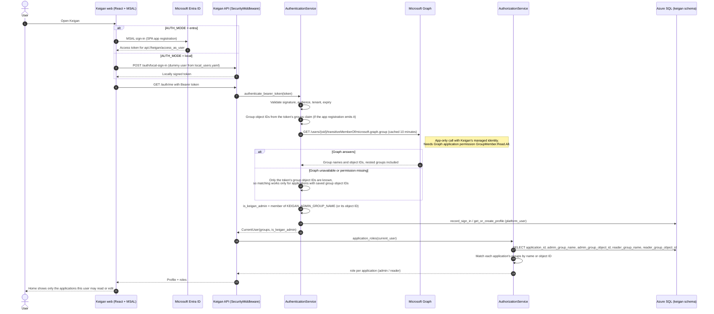
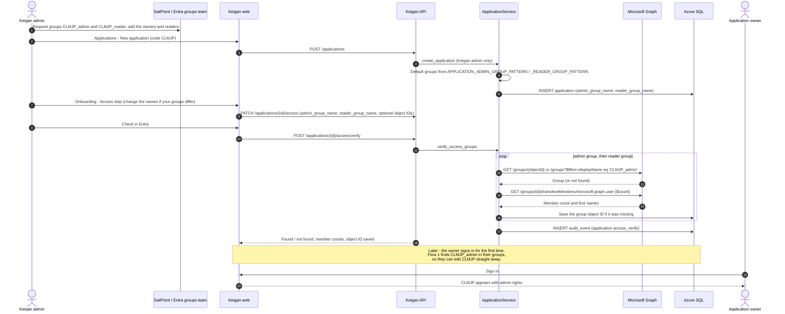
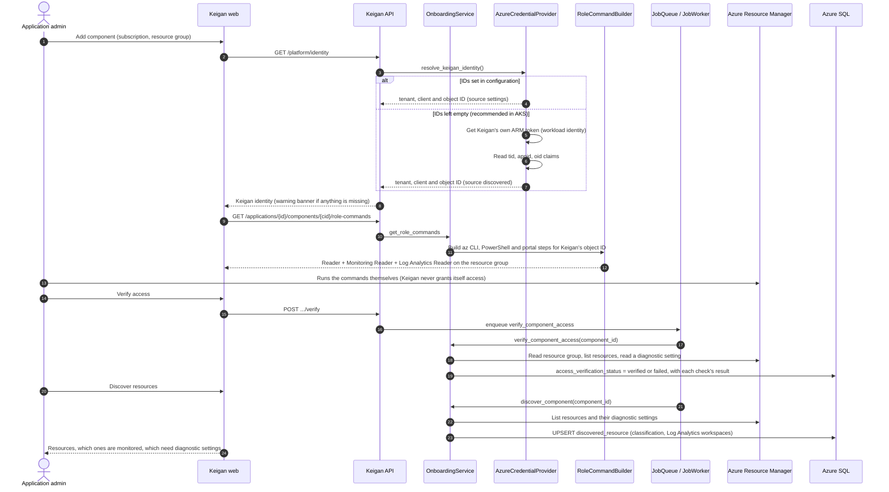
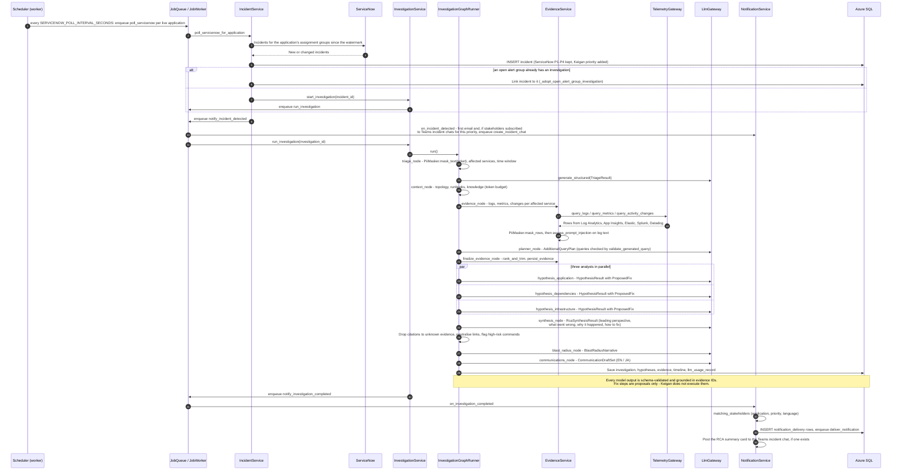
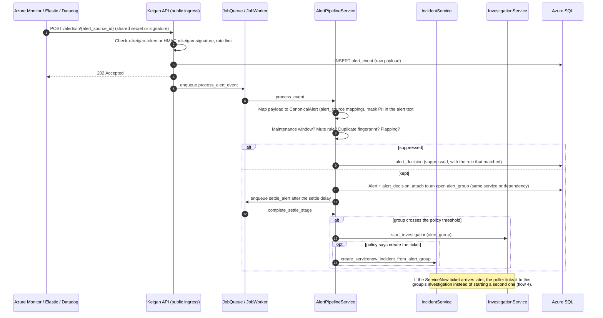
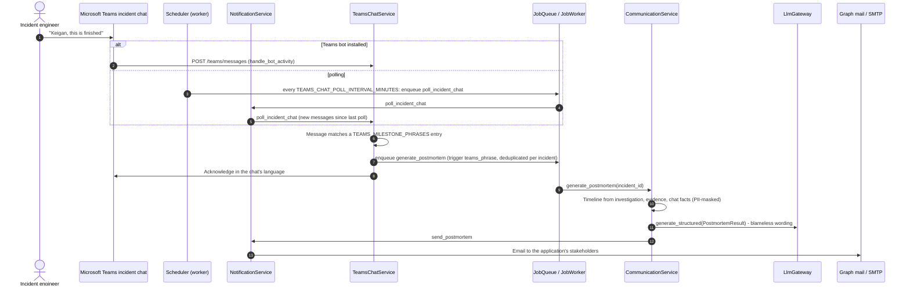
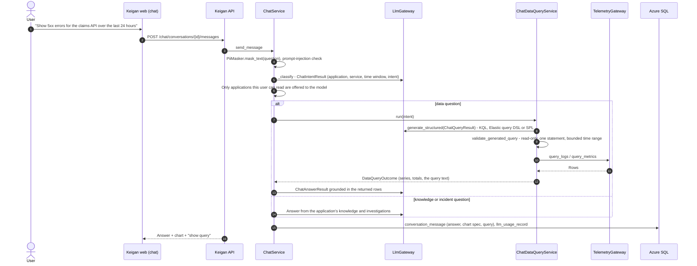
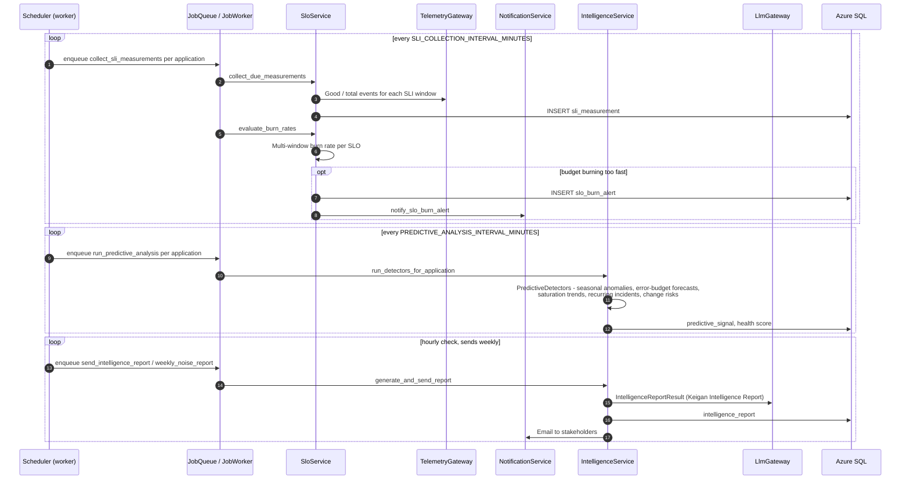

# 13 · Sequence diagrams

The main runtime flows of Keigan, drawn from the code (class and method names are the real ones, so you can search for them).
Diagrams are Mermaid: they render on GitHub, Azure DevOps wikis and in VS Code with a Mermaid preview extension.

| # | Flow | Why it matters |
|---|---|---|
| 1 | [Sign-in and access check](#1-sign-in-and-access-check) | How Keigan knows who is a Keigan admin, an application admin or a reader |
| 2 | [Keigan admin registers an application and its groups](#2-keigan-admin-registers-an-application-and-its-access-groups) | How new `<CODE>_admin` / `<CODE>_reader` groups become known before the owners sign in |
| 3 | [Grant access, verify and discover an Azure component](#3-grant-access-verify-and-discover-an-azure-component) | Which IDs the application team sees and what Keigan checks |
| 4 | [ServiceNow incident to root cause and notifications](#4-servicenow-incident-to-root-cause-and-notifications) | The core investigation pipeline, with PII masking and prompt safety |
| 5 | [Alert webhook to noise-reduced alert group](#5-alert-webhook-to-noise-reduced-alert-group) | Denoising and how an early alert group is adopted by a later ticket |
| 6 | [Teams "Keigan, this is finished" to postmortem email](#6-teams-keigan-this-is-finished-to-postmortem-email) | The milestone phrase flow |
| 7 | [Keigan AI chat: question to query to chart](#7-keigan-ai-chat-question-to-query-to-chart) | Natural language to a validated, read-only telemetry query |
| 8 | [Scheduled work: SLOs, burn alerts and the intelligence report](#8-scheduled-work-slos-burn-alerts-and-the-intelligence-report) | Background jobs and what triggers them |

Common to every flow: the API and the worker are the same image; the worker runs jobs from the `background_job` table
(`JobQueue.enqueue` → `JobWorker` → handler in `workers/job_handlers.py`). Keigan **never** changes a customer system: it
reads telemetry and proposes fixes and commands for a person to run.

## 1. Sign-in and access check

## 2. Keigan admin registers an application and its access groups

Keigan does not need to "discover" new groups. The Keigan admin creates the application, which stores the group
**names** (`<CODE>_admin`, `<CODE>_reader` by default, editable). From then on every sign-in matches the user's groups
against those names (flow 1). "Check in Entra" confirms the groups exist and saves their object IDs, which also
makes matching work when the token carries only IDs.

## 3. Grant access, verify and discover an Azure component

## 4. ServiceNow incident to root cause and notifications

## 5. Alert webhook to noise-reduced alert group

## 6. Teams "Keigan, this is finished" to postmortem email

## 7. Keigan AI chat: question to query to chart

## 8. Scheduled work: SLOs, burn alerts and the intelligence report

