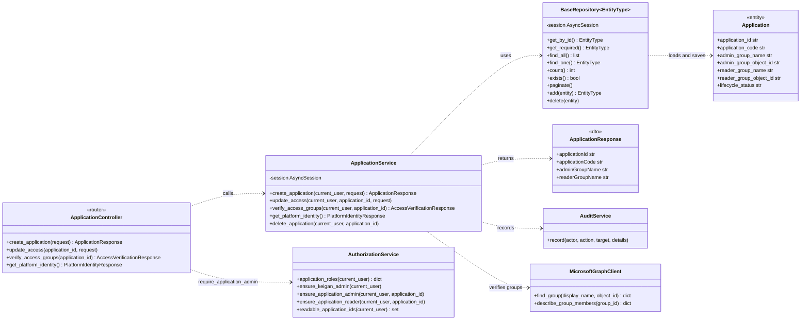
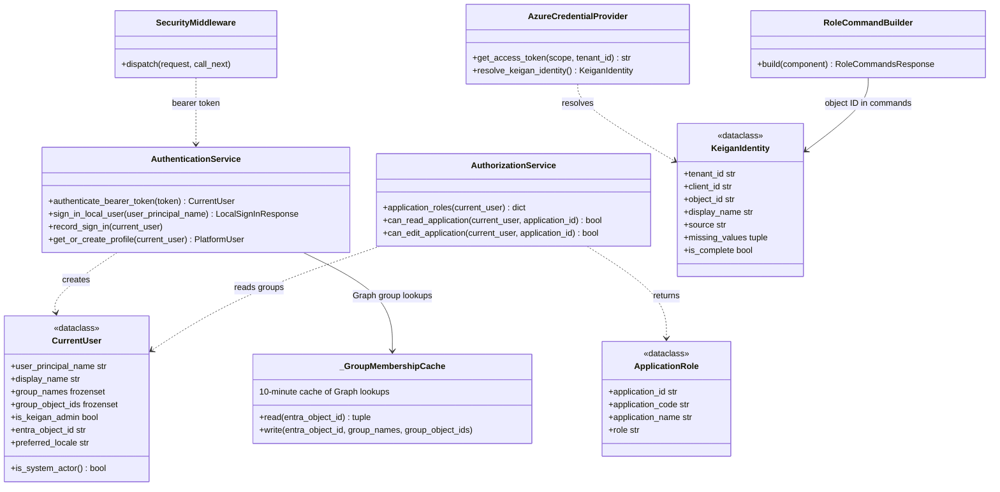
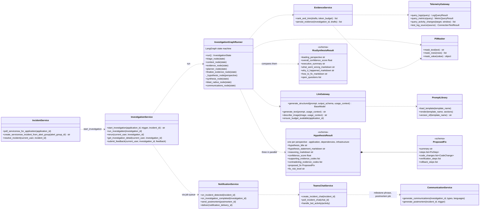
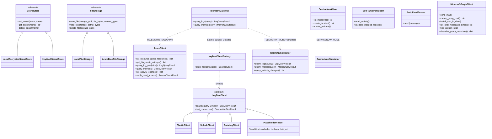
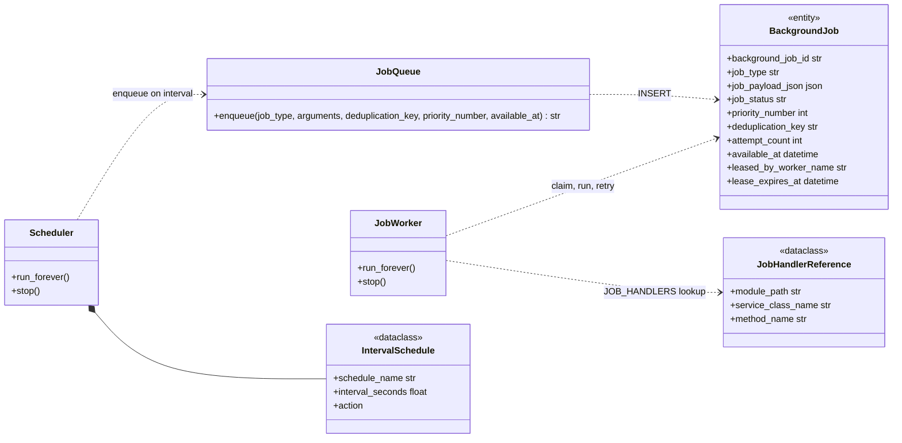
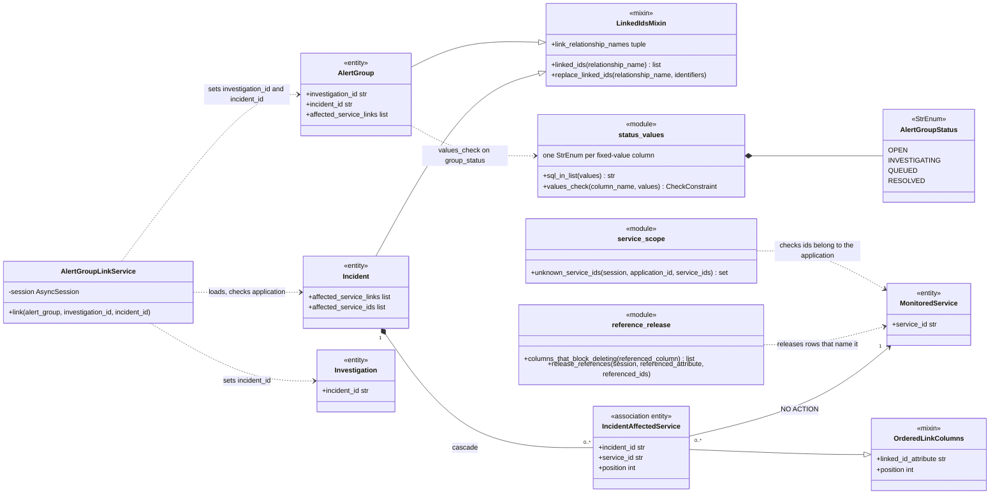

# 14 · Class diagrams

Keigan's backend follows a Java-like layered structure: **controller → service → repository / entity**, with DTOs at the
API edge and integrations behind small interfaces. These diagrams show the main classes and how they depend on each other;
the full list of tables is in [15 · Entity relationship diagram](15_ENTITY_RELATIONSHIP_DIAGRAM.md).

| Package (`backend/keigan/…`) | Holds | Rule |
|---|---|---|
| `controllers/` | FastAPI routers, one per area | Thin: check the role, call one service method, return a DTO |
| `services/` | Business logic, one class per area, constructed per request with the DB session | No HTTP, no SQL strings |
| `repositories/` | `BaseRepository[Entity]` for common queries | Services may also use SQLAlchemy `select()` directly |
| `entities/` | SQLAlchemy tables (`EntityBase`) | The single source of truth for the database and the Azure SQL scripts |
| `dtos/` | Pydantic request/response models (`ApiModel`, camelCase JSON) | Never return entities from controllers |
| `integrations/` | Azure, Graph, ServiceNow, log tools, Teams, email, secrets, files | Each has a live and a simulated mode |
| `ai/` | `LlmGateway`, prompts, output schemas, the investigation graph, prompt safety | Provider-neutral (Gemini, Azure OpenAI, OpenAI-compatible gateway, Anthropic, mock) |
| `workers/` | `JobQueue`, `JobWorker`, `Scheduler` | Jobs live in the `background_job` table |
| `security/` | `CurrentUser`, `SecurityMiddleware`, rate limiter | |
| `utils/` | `PiiMasker`, `query_safety`, log condenser, time and statistics helpers | Pure functions, no I/O |

## 1. Layers and the request path

## 2. Identity and access

## 3. Incidents, investigations and notifications

## 4. Integrations behind interfaces (live or simulated)

## 5. Background work

`JOB_HANDLERS` in `workers/job_handlers.py` maps each job type to a service method, for example
`run_investigation → InvestigationService.run_investigation` and `generate_postmortem → CommunicationService.generate_postmortem`.
Schedules: ServiceNow poll, SLI collection, predictive analysis, Teams chat poll, weekly reports, retention cleanup.

## 6. Linked ids, alert group links, status values and reference release

Four small building blocks keep the data model honest. Lists of ids of other rows are association tables read and written through
`LinkedIdsMixin`; every link between an alert group, an investigation and an incident is written by `AlertGroupLinkService`; every fixed
value set is a `StrEnum` that also becomes the database CHECK constraint; deleting a service, runbook or document releases the rows that
still point at it. Tables and constraints are described in [03 · Database design](03_DATABASE_DESIGN.md) §11 to §14.

- Modules: `entities/linked_ids.py`, `entities/status_values.py`, `services/reference_release.py` and `services/service_scope.py`; the service is
  `services/alert_group_link_service.py`.
- `Incident`, `Investigation`, `AlertGroup`, `Conversation`, `MaintenanceWindow`, `Runbook`, `Stakeholder` and `ApplicationTopology` use
  `LinkedIdsMixin`; `Incident` and `AlertGroup` are shown as the example. Each association entity (nine in all) extends `OrderedLinkColumns`
  and names its linked id column in `linked_id_attribute`.
- `AlertGroupLinkService.link` is the only writer of `alert_group.investigation_id` and `alert_group.incident_id`. It raises
  `NotFoundException` or `ConflictException` instead of storing a combination that disagrees.
- `release_references` walks the foreign keys in the entity metadata, so a new reference is released without editing a list of tables. A
  nullable referencing column is set to NULL, a column that cannot be NULL (an association row) means the row is deleted.
- `unknown_service_ids` is the one check, shared by the alert, investigation, runbook and stakeholder services, that the service ids a user
  sent belong to the application.
