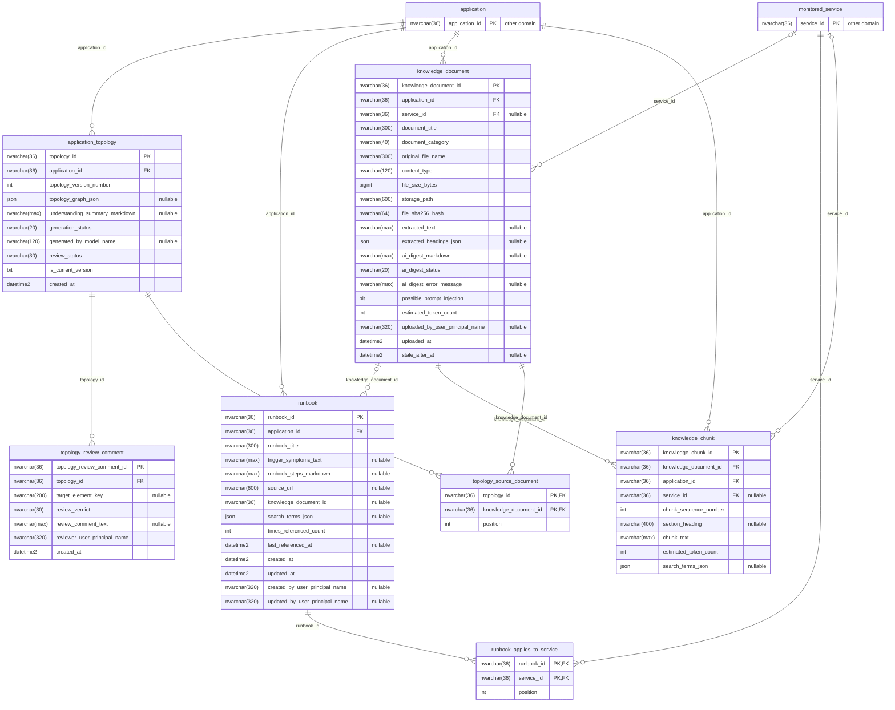
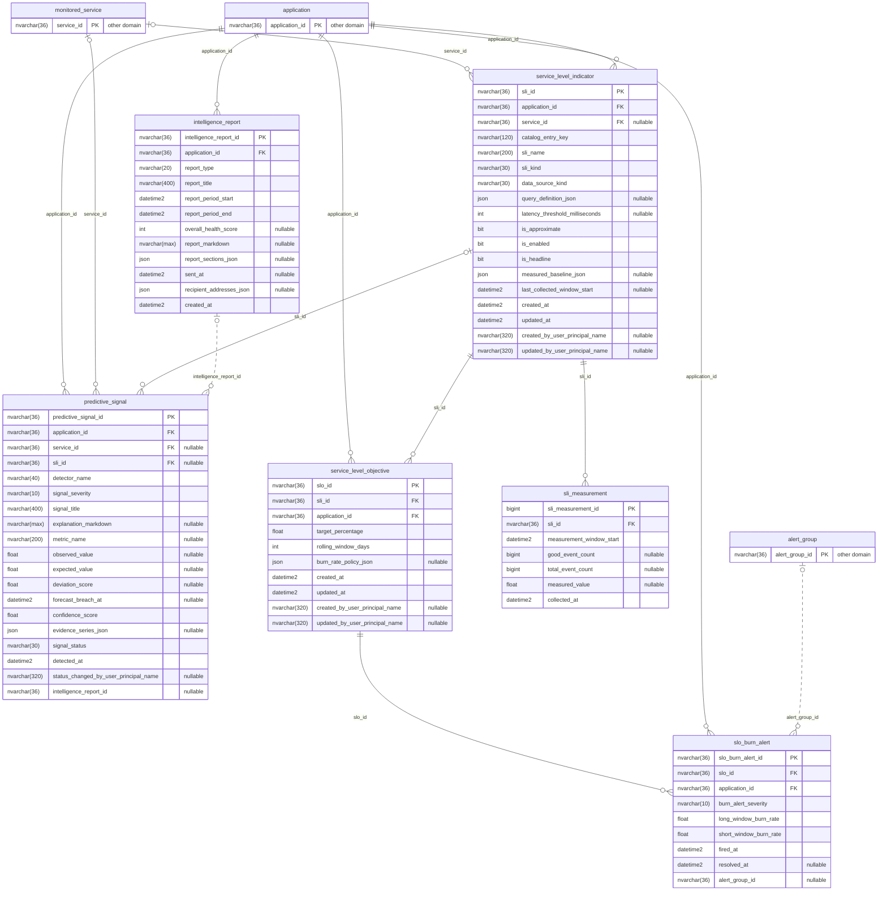
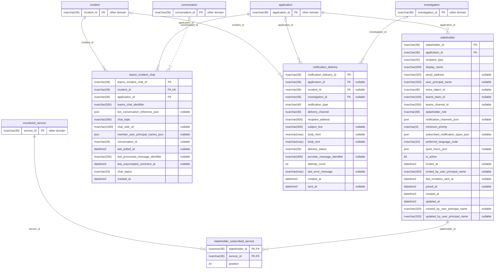
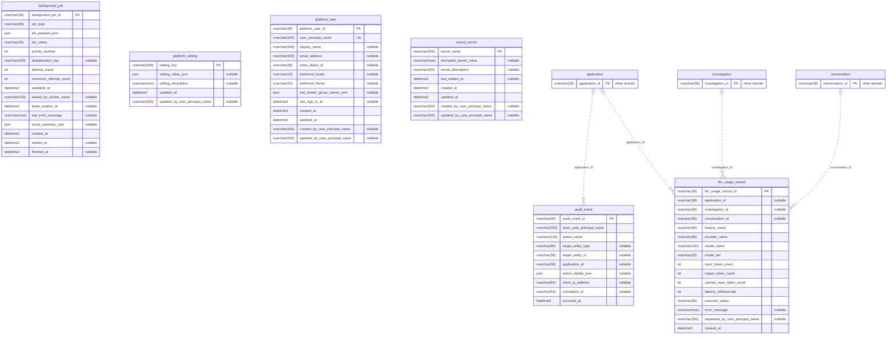

# 15 · Entity relationship diagram

> Generated by `backend/scripts/generate_entity_relationship_diagram.py` from the SQLAlchemy entities (the same source as
> the Azure SQL scripts in `database/azure_sql/`). Do not edit by hand — change the entity and regenerate.

**56 tables · 85 foreign keys · 12 ID references without a foreign key.**

How to read it:

- **Solid line** = foreign key enforced by the database. **Dotted line** = the child stores the parent's ID without a
  foreign key, on purpose: audit and AI-usage history must survive deletes, alerts and incidents link across domains,
  and SQL Server allows only one cascade path to a table.
- `||` exactly one parent · `|o` zero or one parent (nullable column) · `o{` zero or more children.
- Every table also has the columns shown in its domain diagram; times are UTC `DATETIME2(6)`, JSON is stored as `NVARCHAR(max)`.
- In Azure SQL every table lives in the `keigan` schema (`keigan.application`, …).

## Overview — how the tables connect

`application` is the parent of 32 tables through `application_id`.
Those lines are left out here so the rest stays readable; each domain diagram below shows them.

```mermaid
erDiagram
    investigation |o..o{ llm_usage_record : "investigation_id"
    conversation |o..o{ llm_usage_record : "conversation_id"
    knowledge_document |o..o{ runbook : "knowledge_document_id"
    alert_source ||--o{ alert_event : "alert_source_id"
    application_component ||--o{ discovered_resource : "component_id"
    incident |o--o{ investigation : "incident_id"
    application_component |o--o{ monitored_service : "component_id"
    discovered_resource |o..o{ monitored_service : "discovered_resource_id"
    incident ||--o{ teams_incident_chat : "incident_id"
    conversation |o..o{ teams_incident_chat : "conversation_id"
    application_topology ||--o{ topology_review_comment : "topology_id"
    monitored_service |o--o{ alert : "service_id"
    alert_source |o..o{ alert : "alert_source_id"
    alert_group |o..o{ alert : "alert_group_id"
    monitored_service |o--o{ alert_group : "primary_service_id"
    incident |o--o{ alert_group : "incident_id"
    investigation |o--o{ alert_group : "investigation_id"
    incident |o--o{ conversation : "incident_id"
    investigation |o--o{ conversation : "investigation_id"
    incident ||--o{ incident_affected_service : "incident_id"
    monitored_service ||--o{ incident_affected_service : "service_id"
    investigation |o--o{ incident_communication : "investigation_id"
    incident |o--o{ incident_communication : "incident_id"
    investigation ||--o{ investigation_evidence : "investigation_id"
    monitored_service |o--o{ investigation_evidence : "service_id"
    investigation ||--o{ investigation_hypothesis : "investigation_id"
    monitored_service ||--o{ investigation_investigated_service : "service_id"
    investigation ||--o{ investigation_investigated_service : "investigation_id"
    runbook ||--o{ investigation_matched_runbook : "runbook_id"
    investigation ||--o{ investigation_matched_runbook : "investigation_id"
    incident |o--o{ investigation_timeline_event : "incident_id"
    investigation |o--o{ investigation_timeline_event : "investigation_id"
    monitored_service |o--o{ knowledge_document : "service_id"
    monitored_service ||--o{ maintenance_window_applies_to_service : "service_id"
    maintenance_window ||--o{ maintenance_window_applies_to_service : "maintenance_window_id"
    incident |o--o{ notification_delivery : "incident_id"
    investigation |o--o{ notification_delivery : "investigation_id"
    investigation |o--o{ postmortem_report : "investigation_id"
    incident ||--o{ postmortem_report : "incident_id"
    runbook ||--o{ runbook_applies_to_service : "runbook_id"
    monitored_service ||--o{ runbook_applies_to_service : "service_id"
    monitored_service ||--o{ service_dependency : "upstream_service_id"
    monitored_service ||--o{ service_dependency : "downstream_service_id"
    monitored_service |o--o{ service_level_indicator : "service_id"
    log_tool_connection |o--o{ service_log_source : "log_tool_connection_id"
    monitored_service ||--o{ service_log_source : "service_id"
    monitored_service ||--o{ stakeholder_subscribed_service : "service_id"
    stakeholder ||--o{ stakeholder_subscribed_service : "stakeholder_id"
    alert ||--o{ alert_decision : "alert_id"
    alert_group |o..o{ alert_decision : "alert_group_id"
    alert_group ||--o{ alert_group_affected_service : "alert_group_id"
    monitored_service ||--o{ alert_group_affected_service : "service_id"
    conversation ||--o{ conversation_application : "conversation_id"
    conversation ||--o{ conversation_message : "conversation_id"
    knowledge_document ||--o{ knowledge_chunk : "knowledge_document_id"
    monitored_service |o--o{ knowledge_chunk : "service_id"
    monitored_service |o--o{ predictive_signal : "service_id"
    service_level_indicator |o--o{ predictive_signal : "sli_id"
    intelligence_report |o..o{ predictive_signal : "intelligence_report_id"
    service_level_indicator ||--o{ service_level_objective : "sli_id"
    service_level_indicator ||--o{ sli_measurement : "sli_id"
    application_topology ||--o{ topology_source_document : "topology_id"
    knowledge_document ||--o{ topology_source_document : "knowledge_document_id"
    service_level_objective ||--o{ slo_burn_alert : "slo_id"
    alert_group |o..o{ slo_burn_alert : "alert_group_id"
```

## Applications and onboarding

Entity module: `backend/keigan/entities/application_entities.py`

```mermaid
erDiagram
    application {
        nvarchar(36) application_id PK
        nvarchar(200) application_name
        nvarchar(20) application_code UK
        nvarchar(max) application_description "nullable"
        nvarchar(200) business_unit_name "nullable"
        nvarchar(10) region_code "nullable"
        nvarchar(10) primary_locale
        nvarchar(60) time_zone_name
        nvarchar(10) criticality_tier
        nvarchar(20) lifecycle_status
        nvarchar(200) admin_group_name
        nvarchar(36) admin_group_object_id "nullable"
        nvarchar(200) reader_group_name
        nvarchar(36) reader_group_object_id "nullable"
        json incident_creation_policy_json "nullable"
        json onboarding_progress_json "nullable"
        datetime2 went_live_at "nullable"
        nvarchar(320) went_live_by_user_principal_name "nullable"
        datetime2 created_at
        datetime2 updated_at
        nvarchar(320) created_by_user_principal_name "nullable"
        nvarchar(320) updated_by_user_principal_name "nullable"
    }
    application_component {
        nvarchar(36) component_id PK
        nvarchar(36) application_id FK
        nvarchar(40) component_type
        nvarchar(200) component_name
        nvarchar(20) environment_name
        nvarchar(36) azure_tenant_id "nullable"
        nvarchar(36) azure_subscription_id "nullable"
        nvarchar(200) azure_subscription_name "nullable"
        nvarchar(200) azure_resource_group_name "nullable"
        json component_configuration_json "nullable"
        nvarchar(20) access_verification_status
        json access_verification_details_json "nullable"
        datetime2 last_verified_at "nullable"
        datetime2 last_discovered_at "nullable"
        json discovery_summary_json "nullable"
        datetime2 created_at
        datetime2 updated_at
        nvarchar(320) created_by_user_principal_name "nullable"
        nvarchar(320) updated_by_user_principal_name "nullable"
    }
    application_record_link {
        nvarchar(36) application_record_link_id PK
        nvarchar(36) application_id FK
        nvarchar(30) record_system
        nvarchar(100) record_identifier
        nvarchar(30) link_status
        datetime2 created_at
    }
    external_integration {
        nvarchar(36) external_integration_id PK
        nvarchar(36) application_id FK "nullable"
        nvarchar(40) integration_kind
        json integration_configuration_json "nullable"
        nvarchar(200) credential_secret_name "nullable"
        nvarchar(30) integration_status
        nvarchar(max) integration_notes "nullable"
        datetime2 created_at
        datetime2 updated_at
        nvarchar(320) created_by_user_principal_name "nullable"
        nvarchar(320) updated_by_user_principal_name "nullable"
    }
    log_tool_connection {
        nvarchar(36) log_tool_connection_id PK
        nvarchar(36) application_id FK
        nvarchar(40) tool_type
        nvarchar(200) connection_name
        nvarchar(600) endpoint_url "nullable"
        nvarchar(40) authentication_method
        nvarchar(200) credential_secret_name "nullable"
        json connection_configuration_json "nullable"
        nvarchar(30) connection_status
        datetime2 last_tested_at "nullable"
        nvarchar(max) last_test_message "nullable"
        datetime2 newest_log_timestamp_seen_at "nullable"
        datetime2 created_at
        datetime2 updated_at
        nvarchar(320) created_by_user_principal_name "nullable"
        nvarchar(320) updated_by_user_principal_name "nullable"
    }
    discovered_resource {
        nvarchar(36) discovered_resource_id PK
        nvarchar(36) component_id FK
        nvarchar(36) application_id FK
        nvarchar(600) azure_resource_id
        nvarchar(260) resource_name
        nvarchar(200) resource_type
        nvarchar(120) resource_kind "nullable"
        nvarchar(60) location_name "nullable"
        nvarchar(30) monitoring_classification
        bit has_diagnostic_setting
        json diagnostic_settings_json "nullable"
        json log_analytics_workspace_resource_ids_json "nullable"
        json resource_tags_json "nullable"
        datetime2 last_seen_at
        datetime2 no_longer_found_at "nullable"
    }
    monitored_service {
        nvarchar(36) service_id PK
        nvarchar(36) application_id FK
        nvarchar(36) component_id FK "nullable"
        nvarchar(36) discovered_resource_id "nullable"
        nvarchar(200) service_name
        nvarchar(40) service_type
        nvarchar(600) external_resource_identifier "nullable"
        nvarchar(20) environment_name
        nvarchar(10) criticality_tier
        bit is_monitoring_enabled
        nvarchar(200) aks_namespace_filter "nullable"
        nvarchar(600) application_insights_resource_id "nullable"
        nvarchar(200) application_insights_role_name "nullable"
        json available_metrics_json "nullable"
        nvarchar(40) repository_provider "nullable"
        nvarchar(600) repository_url "nullable"
        nvarchar(200) repository_default_branch "nullable"
        nvarchar(400) repository_path "nullable"
        nvarchar(200) repository_credential_secret_name "nullable"
        nvarchar(max) service_description "nullable"
        datetime2 created_at
        datetime2 updated_at
        nvarchar(320) created_by_user_principal_name "nullable"
        nvarchar(320) updated_by_user_principal_name "nullable"
    }
    service_dependency {
        nvarchar(36) service_dependency_id PK
        nvarchar(36) application_id FK
        nvarchar(36) upstream_service_id FK
        nvarchar(36) downstream_service_id FK
        nvarchar(30) dependency_kind
        nvarchar(30) dependency_source
        datetime2 created_at
    }
    service_log_source {
        nvarchar(36) service_log_source_id PK
        nvarchar(36) service_id FK
        nvarchar(40) source_kind
        nvarchar(36) log_tool_connection_id FK "nullable"
        nvarchar(600) log_analytics_workspace_resource_id "nullable"
        nvarchar(36) log_analytics_workspace_customer_id "nullable"
        json query_scope_json "nullable"
        bit is_primary_source
        bit was_auto_detected
        nvarchar(20) last_read_test_status
        datetime2 last_read_test_at "nullable"
        datetime2 created_at
    }
    application ||--o{ application_component : "application_id"
    application ||--o{ application_record_link : "application_id"
    application |o--o{ external_integration : "application_id"
    application ||--o{ log_tool_connection : "application_id"
    application ||--o{ discovered_resource : "application_id"
    application_component ||--o{ discovered_resource : "component_id"
    application_component |o--o{ monitored_service : "component_id"
    application ||--o{ monitored_service : "application_id"
    discovered_resource |o..o{ monitored_service : "discovered_resource_id"
    monitored_service ||--o{ service_dependency : "upstream_service_id"
    monitored_service ||--o{ service_dependency : "downstream_service_id"
    application ||--o{ service_dependency : "application_id"
    log_tool_connection |o--o{ service_log_source : "log_tool_connection_id"
    monitored_service ||--o{ service_log_source : "service_id"
```

## Knowledge base

Entity module: `backend/keigan/entities/knowledge_entities.py`

| Table | Purpose |
|---|---|
| `runbook_applies_to_service` | A service a runbook applies to (an empty list means every service of the application). |
| `topology_source_document` | A document the topology was generated from. |

## Incidents and investigations

Entity module: `backend/keigan/entities/incident_entities.py`

| Table | Purpose |
|---|---|
| `incident_affected_service` | A service an incident affects. The first one is the incident's primary service. |
| `investigation_investigated_service` | A service an investigation examined, in the order triage found them. |
| `investigation_matched_runbook` | A runbook the investigation matched, best match first. |
| `conversation_application` | An application a conversation is scoped to (an empty list means every application the user can read). |

```mermaid
erDiagram
    incident {
        nvarchar(36) incident_id PK
        nvarchar(36) application_id FK
        nvarchar(20) incident_source
        nvarchar(40) external_incident_number "nullable"
        nvarchar(64) external_system_identifier "nullable"
        nvarchar(500) incident_title
        nvarchar(max) incident_description "nullable"
        nvarchar(10) servicenow_priority "nullable"
        nvarchar(10) servicenow_impact "nullable"
        nvarchar(10) servicenow_urgency "nullable"
        nvarchar(4) keigan_priority "nullable"
        nvarchar(max) priority_rationale "nullable"
        nvarchar(40) incident_category "nullable"
        nvarchar(20) incident_status
        nvarchar(200) assignment_group_name "nullable"
        nvarchar(40) external_state "nullable"
        datetime2 opened_at
        datetime2 detected_by_keigan_at
        datetime2 first_update_sent_at "nullable"
        datetime2 resolved_at "nullable"
        datetime2 closed_at "nullable"
        datetime2 external_last_updated_at "nullable"
        datetime2 created_at
        datetime2 updated_at
        nvarchar(320) created_by_user_principal_name "nullable"
        nvarchar(320) updated_by_user_principal_name "nullable"
    }
    servicenow_assignment_group {
        nvarchar(36) assignment_group_id PK
        nvarchar(36) application_id FK
        nvarchar(200) group_name
        nvarchar(64) servicenow_sys_id "nullable"
        nvarchar(20) verification_status
        datetime2 created_at
    }
    investigation {
        nvarchar(36) investigation_id PK
        nvarchar(36) application_id FK
        nvarchar(36) incident_id FK "nullable"
        nvarchar(20) investigation_trigger
        nvarchar(30) investigation_status
        nvarchar(30) current_stage_name
        int progress_percent
        json stage_messages_json "nullable"
        datetime2 investigation_window_start "nullable"
        datetime2 investigation_window_end "nullable"
        datetime2 baseline_window_start "nullable"
        datetime2 baseline_window_end "nullable"
        json triage_result_json "nullable"
        nvarchar(max) executive_summary "nullable"
        nvarchar(max) what_went_wrong_markdown "nullable"
        nvarchar(max) why_it_happened_markdown "nullable"
        nvarchar(max) how_to_fix_markdown "nullable"
        json open_questions_json "nullable"
        float overall_confidence_score "nullable"
        nvarchar(36) leading_hypothesis_id "nullable"
        json blast_radius_json "nullable"
        json knowledge_references_json "nullable"
        nvarchar(20) user_feedback_verdict "nullable"
        nvarchar(max) user_feedback_comment "nullable"
        nvarchar(320) user_feedback_by_user_principal_name "nullable"
        nvarchar(max) failure_reason "nullable"
        int total_input_token_count
        int total_output_token_count
        json model_names_json "nullable"
        nvarchar(320) requested_by_user_principal_name "nullable"
        datetime2 started_at "nullable"
        datetime2 completed_at "nullable"
        datetime2 created_at
        datetime2 updated_at
        nvarchar(320) created_by_user_principal_name "nullable"
        nvarchar(320) updated_by_user_principal_name "nullable"
    }
    conversation {
        nvarchar(36) conversation_id PK
        nvarchar(30) conversation_scope
        nvarchar(36) investigation_id FK "nullable"
        nvarchar(36) incident_id FK "nullable"
        nvarchar(320) owner_user_principal_name "nullable"
        nvarchar(300) conversation_title
        datetime2 created_at
        datetime2 updated_at
        nvarchar(320) created_by_user_principal_name "nullable"
        nvarchar(320) updated_by_user_principal_name "nullable"
    }
    incident_affected_service {
        nvarchar(36) incident_id PK, FK
        nvarchar(36) service_id PK, FK
        int position
    }
    incident_communication {
        nvarchar(36) communication_id PK
        nvarchar(36) incident_id FK "nullable"
        nvarchar(36) investigation_id FK "nullable"
        nvarchar(30) communication_type
        nvarchar(20) audience_type
        nvarchar(10) language_code
        nvarchar(400) subject_line
        nvarchar(max) body_markdown
        nvarchar(20) communication_status
        nvarchar(320) approved_by_user_principal_name "nullable"
        datetime2 approved_at "nullable"
        datetime2 sent_at "nullable"
        datetime2 created_at
        datetime2 updated_at
        nvarchar(320) created_by_user_principal_name "nullable"
        nvarchar(320) updated_by_user_principal_name "nullable"
    }
    investigation_evidence {
        nvarchar(36) evidence_id PK
        nvarchar(36) investigation_id FK
        nvarchar(10) evidence_code
        nvarchar(36) service_id FK "nullable"
        nvarchar(40) evidence_source_kind
        nvarchar(40) evidence_category
        nvarchar(300) evidence_title
        nvarchar(max) evidence_summary "nullable"
        nvarchar(20) query_language
        nvarchar(max) query_text "nullable"
        datetime2 query_time_range_start "nullable"
        datetime2 query_time_range_end "nullable"
        int matched_record_count
        int baseline_record_count "nullable"
        json condensed_patterns_json "nullable"
        json metric_series_json "nullable"
        nvarchar(10) signal_strength
        int masked_value_count
        bit possible_prompt_injection
        nvarchar(1000) deep_link_url "nullable"
        datetime2 collected_at
    }
    investigation_hypothesis {
        nvarchar(36) hypothesis_id PK
        nvarchar(36) investigation_id FK
        nvarchar(20) analysis_perspective
        nvarchar(300) hypothesis_title
        nvarchar(max) hypothesis_statement_markdown "nullable"
        nvarchar(max) reasoning_markdown "nullable"
        float confidence_score
        json supporting_evidence_codes_json "nullable"
        json contradicting_evidence_codes_json "nullable"
        json proposed_fix_json "nullable"
        nvarchar(10) fix_risk_level
        nvarchar(36) matched_runbook_id "nullable"
        bit is_leading_hypothesis
        int display_order
        datetime2 created_at
    }
    investigation_investigated_service {
        nvarchar(36) investigation_id PK, FK
        nvarchar(36) service_id PK, FK
        int position
    }
    investigation_matched_runbook {
        nvarchar(36) investigation_id PK, FK
        nvarchar(36) runbook_id PK, FK
        int position
    }
    investigation_timeline_event {
        nvarchar(36) timeline_event_id PK
        nvarchar(36) incident_id FK "nullable"
        nvarchar(36) investigation_id FK "nullable"
        datetime2 event_occurred_at
        nvarchar(40) event_type
        nvarchar(400) event_title
        nvarchar(max) event_details_markdown "nullable"
        nvarchar(40) event_source
        nvarchar(400) source_reference "nullable"
        nvarchar(200) actor_display_name "nullable"
        datetime2 created_at
    }
    postmortem_report {
        nvarchar(36) postmortem_id PK
        nvarchar(36) incident_id FK
        nvarchar(36) investigation_id FK "nullable"
        nvarchar(400) report_title
        nvarchar(max) report_markdown "nullable"
        json report_sections_json "nullable"
        nvarchar(10) language_code
        nvarchar(20) report_status
        nvarchar(30) generation_trigger
        nvarchar(320) finalized_by_user_principal_name "nullable"
        datetime2 finalized_at "nullable"
        datetime2 sent_at "nullable"
        datetime2 created_at
        datetime2 updated_at
        nvarchar(320) created_by_user_principal_name "nullable"
        nvarchar(320) updated_by_user_principal_name "nullable"
    }
    conversation_application {
        nvarchar(36) conversation_id PK, FK
        nvarchar(36) application_id PK, FK
        int position
    }
    conversation_message {
        nvarchar(36) message_id PK
        nvarchar(36) conversation_id FK
        nvarchar(20) author_role
        nvarchar(200) author_display_name "nullable"
        nvarchar(320) author_user_principal_name "nullable"
        nvarchar(max) message_text
        json message_payload_json "nullable"
        nvarchar(200) external_message_identifier "nullable"
        int input_token_count
        int output_token_count
        datetime2 created_at
    }
    application {
        nvarchar(36) application_id PK "other domain"
    }
    monitored_service {
        nvarchar(36) service_id PK "other domain"
    }
    runbook {
        nvarchar(36) runbook_id PK "other domain"
    }
    application ||--o{ incident : "application_id"
    application ||--o{ servicenow_assignment_group : "application_id"
    incident |o--o{ investigation : "incident_id"
    application ||--o{ investigation : "application_id"
    incident |o--o{ conversation : "incident_id"
    investigation |o--o{ conversation : "investigation_id"
    incident ||--o{ incident_affected_service : "incident_id"
    monitored_service ||--o{ incident_affected_service : "service_id"
    investigation |o--o{ incident_communication : "investigation_id"
    incident |o--o{ incident_communication : "incident_id"
    investigation ||--o{ investigation_evidence : "investigation_id"
    monitored_service |o--o{ investigation_evidence : "service_id"
    investigation ||--o{ investigation_hypothesis : "investigation_id"
    monitored_service ||--o{ investigation_investigated_service : "service_id"
    investigation ||--o{ investigation_investigated_service : "investigation_id"
    runbook ||--o{ investigation_matched_runbook : "runbook_id"
    investigation ||--o{ investigation_matched_runbook : "investigation_id"
    incident |o--o{ investigation_timeline_event : "incident_id"
    investigation |o--o{ investigation_timeline_event : "investigation_id"
    investigation |o--o{ postmortem_report : "investigation_id"
    incident ||--o{ postmortem_report : "incident_id"
    application ||--o{ conversation_application : "application_id"
    conversation ||--o{ conversation_application : "conversation_id"
    conversation ||--o{ conversation_message : "conversation_id"
```

## Alerts and noise reduction

Entity module: `backend/keigan/entities/alert_entities.py`

| Table | Purpose |
|---|---|
| `maintenance_window_applies_to_service` | A service a maintenance window applies to (an empty list means every service of the application). |
| `alert_group_affected_service` | A service an alert group touches; the first one is the group's first service. |

```mermaid
erDiagram
    alert_mute_rule {
        nvarchar(36) mute_rule_id PK
        nvarchar(36) application_id FK
        nvarchar(200) rule_name
        json matcher_json
        nvarchar(max) mute_reason
        datetime2 expires_at
        datetime2 created_at
        datetime2 updated_at
        nvarchar(320) created_by_user_principal_name "nullable"
        nvarchar(320) updated_by_user_principal_name "nullable"
    }
    alert_source {
        nvarchar(36) alert_source_id PK
        nvarchar(36) application_id FK
        nvarchar(30) source_tool
        nvarchar(200) source_name
        nvarchar(128) webhook_secret_hash
        nvarchar(128) previous_webhook_secret_hash "nullable"
        datetime2 previous_secret_valid_until "nullable"
        nvarchar(200) webhook_secret_name "nullable"
        nvarchar(200) previous_webhook_secret_name "nullable"
        json field_mapping_json "nullable"
        json severity_mapping_json "nullable"
        json service_mapping_json "nullable"
        nvarchar(30) source_status
        datetime2 last_received_at "nullable"
        int received_alert_count
        int authentication_failure_count
        datetime2 created_at
        datetime2 updated_at
        nvarchar(320) created_by_user_principal_name "nullable"
        nvarchar(320) updated_by_user_principal_name "nullable"
    }
    maintenance_window {
        nvarchar(36) maintenance_window_id PK
        nvarchar(36) application_id FK
        nvarchar(200) window_name
        json applies_to_environments_json "nullable"
        datetime2 starts_at
        datetime2 ends_at
        bit repeats_weekly
        datetime2 created_at
        datetime2 updated_at
        nvarchar(320) created_by_user_principal_name "nullable"
        nvarchar(320) updated_by_user_principal_name "nullable"
    }
    noise_reduction_policy {
        nvarchar(36) application_id PK, FK
        json policy_settings_json
        nvarchar(10) policy_mode
        datetime2 observe_mode_started_at "nullable"
        datetime2 created_at
        datetime2 updated_at
        nvarchar(320) created_by_user_principal_name "nullable"
        nvarchar(320) updated_by_user_principal_name "nullable"
    }
    alert_event {
        nvarchar(36) alert_event_id PK
        nvarchar(36) alert_source_id FK
        nvarchar(36) application_id FK
        datetime2 received_at
        json raw_payload_json "nullable"
        int payload_size_bytes
        nvarchar(20) processing_status
        nvarchar(max) processing_error_message "nullable"
    }
    alert {
        nvarchar(36) alert_id PK
        nvarchar(36) application_id FK
        nvarchar(36) alert_source_id "nullable"
        nvarchar(400) external_alert_identifier "nullable"
        nvarchar(64) alert_fingerprint
        nvarchar(600) rule_identifier "nullable"
        nvarchar(400) rule_name
        nvarchar(36) service_id FK "nullable"
        nvarchar(600) resource_reference "nullable"
        nvarchar(20) environment_name "nullable"
        int severity_level
        nvarchar(20) alert_status
        nvarchar(1000) alert_summary
        nvarchar(max) alert_description "nullable"
        nvarchar(1000) alert_link_url "nullable"
        json alert_labels_json "nullable"
        int occurrence_count
        int state_change_count
        bit is_flapping
        datetime2 first_seen_at
        datetime2 last_seen_at
        datetime2 resolved_at "nullable"
        nvarchar(36) alert_group_id "nullable"
        nvarchar(30) final_disposition "nullable"
        nvarchar(36) latest_alert_event_id "nullable"
    }
    alert_group {
        nvarchar(36) alert_group_id PK
        nvarchar(36) application_id FK
        nvarchar(400) group_title
        nvarchar(max) group_summary "nullable"
        nvarchar(20) group_status
        float priority_score
        nvarchar(400) grouping_reason "nullable"
        int member_alert_count
        nvarchar(36) primary_service_id FK "nullable"
        int highest_severity_level
        datetime2 started_at
        datetime2 last_activity_at
        datetime2 resolved_at "nullable"
        nvarchar(36) investigation_id FK "nullable"
        nvarchar(36) incident_id FK "nullable"
        bit servicenow_incident_suggested
        nvarchar(20) user_feedback_verdict "nullable"
        nvarchar(max) user_feedback_reason "nullable"
        nvarchar(320) user_feedback_by_user_principal_name "nullable"
    }
    maintenance_window_applies_to_service {
        nvarchar(36) maintenance_window_id PK, FK
        nvarchar(36) service_id PK, FK
        int position
    }
    alert_decision {
        nvarchar(36) alert_decision_id PK
        nvarchar(36) alert_id FK
        nvarchar(36) alert_group_id "nullable"
        nvarchar(20) pipeline_stage
        nvarchar(40) decision_outcome
        nvarchar(600) decision_reason
        nvarchar(40) would_have_outcome_in_active_mode "nullable"
        datetime2 decided_at
    }
    alert_group_affected_service {
        nvarchar(36) alert_group_id PK, FK
        nvarchar(36) service_id PK, FK
        int position
    }
    application {
        nvarchar(36) application_id PK "other domain"
    }
    incident {
        nvarchar(36) incident_id PK "other domain"
    }
    investigation {
        nvarchar(36) investigation_id PK "other domain"
    }
    monitored_service {
        nvarchar(36) service_id PK "other domain"
    }
    application ||--o{ alert_mute_rule : "application_id"
    application ||--o{ alert_source : "application_id"
    application ||--o{ maintenance_window : "application_id"
    application ||--o{ noise_reduction_policy : "application_id"
    application ||--o{ alert_event : "application_id"
    alert_source ||--o{ alert_event : "alert_source_id"
    monitored_service |o--o{ alert : "service_id"
    application ||--o{ alert : "application_id"
    alert_source |o..o{ alert : "alert_source_id"
    alert_group |o..o{ alert : "alert_group_id"
    application ||--o{ alert_group : "application_id"
    monitored_service |o--o{ alert_group : "primary_service_id"
    incident |o--o{ alert_group : "incident_id"
    investigation |o--o{ alert_group : "investigation_id"
    monitored_service ||--o{ maintenance_window_applies_to_service : "service_id"
    maintenance_window ||--o{ maintenance_window_applies_to_service : "maintenance_window_id"
    alert ||--o{ alert_decision : "alert_id"
    alert_group |o..o{ alert_decision : "alert_group_id"
    alert_group ||--o{ alert_group_affected_service : "alert_group_id"
    monitored_service ||--o{ alert_group_affected_service : "service_id"
```

## SLIs and SLOs

Entity module: `backend/keigan/entities/slo_entities.py`

## Notifications and incident chats

Entity module: `backend/keigan/entities/notification_entities.py`

| Table | Purpose |
|---|---|
| `stakeholder_subscribed_service` | A service a stakeholder wants notifications about (an empty list means every service). |

## Platform (users, settings, jobs, audit, AI usage)

Entity module: `backend/keigan/entities/platform_entities.py`

