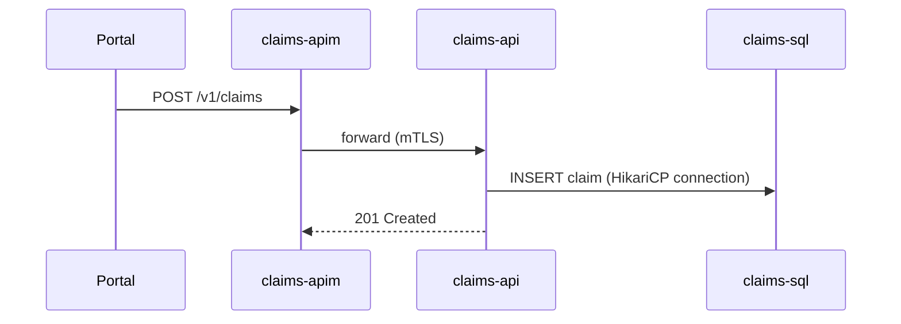

# claims-api

## Purpose
Core REST API of Claims Processing (JP). It accepts claim submissions from the customer portal and agent desktop, validates them, stores them in SQL and orchestrates assessment and payout.
Callers: claims-apim (all external traffic), claims-intake-func (batch intake). Dependants: claims-document-renderer, claims-workflow.

## Runtime and hosting
- Java 17, Spring Boot 3.2, built with Maven (`pom.xml`).
- AKS cluster `azjpeaaks21530pr01`, namespace `claims`, Deployment `claims-api`, 4 replicas (HPA 4-10 on CPU 70%).
- Requests 500m CPU / 1Gi memory, limits 1 CPU / 2Gi. Readiness probe `/actuator/health/readiness`, liveness `/actuator/health/liveness`.

## Entry points and APIs
| Method | Path | Handler | Notes |
|---|---|---|---|
| POST | /v1/claims | ClaimsController.submitClaim | Idempotency-Key header required |
| GET | /v1/claims/{claimId} | ClaimsController.getClaim | |
| POST | /v1/claims/{claimId}/documents | DocumentController.requestRender | calls claims-document-renderer |
| GET | /v1/claims/{claimId}/status | ClaimsController.getStatus | polled by the portal every 5 s |

## Sequence diagrams

## Class / module overview
- `jp.metlife.claims.web` controllers and exception mapping (`GlobalExceptionHandler`).
- `jp.metlife.claims.service.ClaimService` validation, assessment routing, transaction boundary.
- `jp.metlife.claims.repository` Spring Data JPA repositories over SQL.
- `jp.metlife.claims.client.RendererClient` WebClient to claims-document-renderer.

## Data stores
- Azure SQL database `claims-sql` (schema `clm`). HikariCP: `maximumPoolSize=40`, `connectionTimeout=30000 ms`, `maxLifetime=1800000 ms` (`application-prod.yml`).
- Flyway migrations in `src/main/resources/db/migration`.

## Outbound dependencies
| Dependency | Protocol | Timeout | Retry |
|---|---|---|---|
| claims-sql | JDBC | 30 s connection, 60 s query | none (fail fast) |
| claims-document-renderer | HTTPS | 10 s | 2 retries, 500 ms backoff |
| Azure Service Bus topic `claims-events` | AMQP | 15 s | SDK default |

## Configuration and feature flags
- `claims.assessment.autoRoute.enabled` (default true) routes low-value claims automatically.
- `spring.datasource.hikari.maximum-pool-size` set in the Helm values `values-prod.yaml`.
- Secrets come from Key Vault `kv-clmjp-prd` through the CSI driver.

## Deployment route
Azure DevOps pipeline `azure-pipelines.yml`: build, test, image to `acrclmjp.azurecr.io`, deploy to `uat` then `prod` namespaces with Helm release `claims-api`. Rollback: `helm rollback claims-api <revision>`.

## Logging and telemetry
- JSON logs with `traceId`, `claimId`, `customerRef` (masked) and `logger`. Application Insights role name `claims-api`.
- Query exceptions: `AppExceptions | where AppRoleName == "claims-api"`; slow dependencies: `AppDependencies | where Target contains "claims-sql"`.

## Known failure modes
- Connection pool exhaustion: HikariCP pending threads climb, requests wait 30 s then fail with `SQLTransientConnectionException: Connection is not available`. Confirm with SQL `sessions_percent` above 90 and rising p95 latency. Mitigate by restarting the slowest pods and raising the pool temporarily.
- Renderer unavailable: `RendererClient` retries twice and returns 502 to the caller; claim submission itself is unaffected.

## Operational commands
- `kubectl -n claims get pods -l app=claims-api`
- `kubectl -n claims logs deploy/claims-api --since=15m | grep SQLTransientConnectionException`
- `kubectl -n claims rollout restart deploy/claims-api` (risk: brief capacity drop)

## Owners
Team JP-Claims-DevOps. Support group JP-Claims-L2-Support. Repository: Azure DevOps `CLMJP/claims-api`.
